# Sawtooth Industrial Systems: Wholesale Line Card & Distributor Playbook

> **Target Entity:** Sawtooth Industrial Systems LLC (`siscontrols.com`)  
> **Prepared For:** Brandon | Sourcing Director & Principal  
> **Applicable Sourcing:** Wholesale Electrical Distribution & Component Arbitrage  
> **Last Verified:** October 2026

---

## 1. Executive Sourcing Strategy

The fundamental profit engine of Sawtooth Industrial Systems is **component sourcing arbitrage**. Traditional panel shops mark up whatever catalog parts their local distributor counter stocks at standard trade discounts (typically 15% to 25% gross margin). By contrast, Sawtooth leverages:
1. Direct wholesale credit lines across multiple competing distributor networks.
2. Project-specific Special Pricing Agreements (SPA) registered directly with manufacturers.
3. Rapid cross-referencing of long-lead conglomerate parts with drop-in functional equivalents compliant with UL 508A Supplement SA.
4. Strategic regional freight corridors (Sparks, NV and Salt Lake City hubs) delivering enclosures and VFDs in 1 to 2 business days.

---

## 2. Wholesale Distributor Channel Matrix

| Distributor | Key Line Cards | Regional Branch Focus | Sourcing Strategy & Account Type |
| :--- | :--- | :--- | :--- |
| **CED (Consolidated Electrical Distributors)** | Rockwell Automation (Allen-Bradley), Hoffman, SolaHD, Littelfuse | Boise (Gowen Rd) & Nampa | **Primary Rockwell Channel:** CED holds the Authorized Product Reseller (APR) franchise for Rockwell in Ada/Canyon counties. Open a commercial Net-30 credit line ($50,000 baseline) for Allen-Bradley PLCs (5069 CompactLogix) and PowerFlex 525/755 drives. |
| **Platt Electric Supply (Rexel)** | Eaton, Siemens, ABB, Panduit, Southwire, Saginaw | Boise (Federal Way & Chinden) | **Secondary Power & Distribution Channel:** Platt carries deep inventory of Eaton molded case circuit breakers (MCCB), heavy copper wire, terminal blocks, and Saginaw enclosures. Fast will-call response for fast-turnaround jobs. |
| **AutomationDirect** | Productivity PLCs, IronHorse motors, Stride switches, GS series VFDs | Direct Factory Online (Atlanta Hub) | **High-Margin Value Channel:** Direct-to-OEM pricing with 40% to 55% margins. Free 2-day ground shipping to Boise on orders over $49. Ideal for agricultural pumping panels, food processing conveyors, and budget-sensitive OEMs. |
| **Saginaw Control & Engineering (SCE)** | NEMA 1, 3R, 4, 4X, and 12 Carbon & Stainless Enclosures | Sparks, NV Distribution Hub | **Enclosure Freight Arbitrage:** SCE maintains a massive master warehouse in Sparks, NV. Shipments to Boise arrive in 1 to 2 business days via standard LTL freight, completely bypassing the 8 to 14 week lead times of Midwest enclosure builders. |
| **Rittal North America** | VX25 Modular Baying, Hygienic HD 316L, Blue e+ Climate Units | Sparks, NV & Reno Hubs | **High-Spec Mission-Critical Line:** Premier line for 40kW-120kW+ AI data center CDU skids and Magic Valley sanitary food washdown skids (30° slope-top hygienic enclosures and inverter AC units). |

---

## 3. Special Pricing Agreements (SPA) & Multiplier Mechanics

Wholesale electrical pricing is driven by **book multipliers** applied to list prices:

$$\text{Net Cost} = \text{Manufacturer List Price} \times \text{Distributor Multiplier}$$

Typical commercial trade multipliers range from $0.45$ to $0.65$ (meaning a \$1,000 list breaker costs \$450 to \$650). However, on major capital projects, Brandon can secure a **Special Pricing Agreement (SPA)** or "into-stock rebate":

### How to Lock in an SPA with CED and Platt:
1. **Identify the Capital Project:** Document the end-user (e.g., Micron Project Triton, Meta Kuna Hyperscale, Chobani Twin Falls).
2. **Contact the Manufacturer Field Sales Rep:** Introduce Sawtooth as the minority-owned (MBE) sourcing partner quoting the project's control packages.
3. **Request a Project Registration SPA:** The manufacturer rep issues a unique SPA authorization code (e.g., `SPA-ROCKWELL-84021`) to CED or Platt.
4. **Multiplier Reduction:** The SPA drops your multiplier down to $0.28$ to $0.35$ (a 25% to 35% cost reduction below standard wholesale), widening your gross profit margin to 40% to 50% on bill-of-materials sourcing.

---

## 4. Component Cross-Referencing & UL 508A Supplement SA Compliance

When Rockwell or Eaton lead times blow out to 50+ weeks, customers risk severe project delays. Sawtooth solves this with **pre-engineered drop-in substitutions** compliant with UL 508A Supplement SA:

| Primary Long-Lead Component | Typical Conglomerate Delay | Approved Functional Equivalent | Equivalent Lead Time | Technical Notes |
| :--- | :--- | :--- | :--- | :--- |
| **Allen-Bradley 140G Breakers** (15A to 250A) | 42 to 65 Weeks | **Eaton Cutler-Hammer Series G (HMCP)** or **ABB SACE Tmax XT** | 2 to 4 Weeks | Direct physical drop-in. Verify that fault withstand rating meets or exceeds customer schematic (minimum 65kA @ 480V). |
| **Allen-Bradley PowerFlex 525** (5 to 30 HP) | 36 to 52 Weeks | **ABB ACS580** or **Schneider Altivar ATV630** | 1 to 3 Weeks | Both support native EtherNet/IP and Modbus TCP/IP protocols with dual-port Ethernet daisy-chaining. |
| **Rockwell 1606-XLS Power Supply** (24VDC 10A/20A) | 26 to 40 Weeks | **PULS Dimension QT20** or **Phoenix Contact QUINT4** | In Stock (2 Days) | PULS is the actual German OEM that manufactures Rockwell's high-tier power supplies. Superior 95.4% efficiency and active transient suppression. |
| **Hoffman Concept Enclosures** (NEMA 4X 316L) | 12 to 18 Weeks | **Saginaw SCE-HD** or **Rittal Hygienic Design (HD)** | 2 to 4 Days (Sparks, NV Hub) | Saginaw SCE-HD features exact 316L brushed grain finish and seamless silicone pour-in-place gaskets. |
| **Allen-Bradley 1769-OB32 Digital Output** | 30 to 45 Weeks | **AutomationDirect Productivity2000** or **Siemens S7-1500** | In Stock (3 Days) | For OEM skid lines where platform brand is open, substituting Productivity2000 reduces PLC hardware costs by 60% with zero lead time delay. |

### The Supplement SA Verification Rule:
Under UL 508A Supplement SA (Table SA1.1), substituting a listed component (such as an MCCB, motor controller, or power supply) does **not** invalidate the panel's Short-Circuit Current Rating (SCCR) provided:
1. The replacement component holds an equal or higher interrupting rating (kA) at the applied voltage.
2. The component is marked as suitable for branch circuit protection (UL 489 for circuit breakers).
3. The peak let-through current ($I_{peak}$) and clearing energy ($I^2t$) of the replacement protective device do not exceed the original component's ratings.

---

## 5. Daily Sourcing & Procurement Workflow (RFQ to Cash)

```mermaid
flowchart LR
    A["Customer Submits Prints (/rfq/ or /builder/)"] --> B["BOM Extraction in Excel/ERP (24 Hours)"]
    B --> C["Portal Price Check: CED, Platt & AutomationDirect"]
    C --> D["Identify Long-Lead Choke Points & Cross-Reference"]
    D --> E["Send Prints to Partner UL 508A Shop for Labor Bid"]
    E --> F["Consolidate Quote: BOM Cost + Partner Labor + Sawtooth Margin (30-45%)"]
    F --> G["Present Formal 24-48 Hr Proposal to Customer"]
    G --> H["PO Received -> 50% Milestone Down -> Order Hardware"]
    H --> I["Partner Shop Assembly -> 100% FAT Sign-Off -> Final 50% Balance -> Freight to Site"]
```

### Daily Operations Step-by-Step:
1. **Intake (Hours 0 to 4):** Receive CAD DWG, PDF schematic, or builder configuration from `/builder/` or `/rfq/`.
2. **Component Sourcing & Multiplier Check (Hours 4 to 18):** Check live portal stock across CED, Platt, AutomationDirect, and Saginaw. If long-lead items exist (> 8 weeks), prepare alternate BOM with approved functional equivalents.
3. **Partner Fabrication Bid (Hours 18 to 30):** Upload prints to partner shop secure portal; partner shop quotes labor ($65 to $85/hr, estimated 35 to 80 hours depending on panel density).
4. **Margin Consolidation & Proposal Generation (Hours 30 to 40):** Calculate subtotal:
   $$\text{Customer Bid} = \frac{\text{BOM Cost} + \text{Shop Labor Cost}}{1 - \text{Target Gross Margin (0.35)}}$$
5. **Customer Presentation & Closing (Hour 48):** Dispatch branded technical proposal with preliminary BOM, lead time guarantee (8 to 12 weeks), and capability statement attachment.
